<p align="center">
  
</p>

<h1 align="center">DetectionHammer</h1>
<p align="center"><strong>Prove what your defenses can see.</strong></p>
<p align="center">Active Directory · Detection Engineering · Evidence Validation</p>

<p align="center">
  <a href="https://github.com/icedracon/DetectionHammer/actions/workflows/evidence-checks.yml"></a>
  
  
  
</p>

<p align="center">
  <a href="#quickstart"><strong>Quickstart</strong></a> ·
  <a href="skills/detectionhammer-ad/SKILL.md">Skill</a> ·
  <a href="#evidence-validation">Evidence</a> ·
  <a href="docs/index.html">Product tour source</a> ·
  <a href="https://github.com/icedracon/DetectionHammer/issues">Feedback</a>
</p>

> [!IMPORTANT]
> **Development preview | Next planned release: v0.0.1-beta.** This repository currently contains the standalone skill, 12 domain-level review methods, offline evidence evaluator and tests. The full 150-card beta source and experimental Sigma pack must be imported before the beta is published. Native agent installation, SIEM compilation and live detection validation remain unverified.

## Why DetectionHammer?

A missing alert is not proof of a missed attack. DetectionHammer gives defenders an evidence-first workflow for authorized Active Directory security reviews.

| Review dimension | What we establish |
| :--- | :--- |
| **Posture** | What configuration and security controls are observed |
| **Execution** | Whether an authorized activity has independent evidence |
| **Telemetry** | Whether relevant raw observations are available |
| **Alert** | Whether a matching alert is supported by correlation |
| **Prevention** | Whether a control outcome is independently supported |

**Observe → Correlate → Challenge → Qualify → Report.** The skill treats uncertainty as a result, not a defect to hide. It is not an attack executor or a SIEM connector.

<p align="center"></p>

## Quickstart

From your own project directory, clone this repository, then copy the self-contained skill folder into your agent's project skill directory.

**Claude Code (Linux/macOS/Git Bash)**

```sh
git clone https://github.com/icedracon/DetectionHammer.git
mkdir -p .claude/skills
cp -R DetectionHammer/skills/detectionhammer-ad .claude/skills/
```

**Codex**

```sh
git clone https://github.com/icedracon/DetectionHammer.git
mkdir -p .agents/skills
cp -R DetectionHammer/skills/detectionhammer-ad .agents/skills/
```

**Windows PowerShell**

```powershell
git clone https://github.com/icedracon/DetectionHammer.git
New-Item -ItemType Directory -Force .claude/skills, .agents/skills | Out-Null
Copy-Item -Recurse DetectionHammer/skills/detectionhammer-ad .claude/skills/
Copy-Item -Recurse DetectionHammer/skills/detectionhammer-ad .agents/skills/
```

Refresh or restart skill discovery if needed. Client compatibility and plugin loading need native smoke tests. This is not an official ChatGPT Plugins Directory listing.

Example request:

> Use detectionhammer-ad to review my authorized AD lab's sanitized security events. Separate raw telemetry, correlated alerts and prevention evidence. Explain evidence gaps and suggest defensive rule improvements.

## Twelve AD security domains

<p align="center"></p>

Read [domain review methods](skills/detectionhammer-ad/references/domain-review.md) for the current review workflow, required evidence and legitimate alternative explanations for every domain.

The earlier RC archive has 150 scenario cards across Kerberos (20), NTLM (12), LDAP (10), AD CS/PKI (20), delegation (12), ACLs (15), domain controllers/replication (10), GPO (10), lateral movement (12), identity (10), trusts (9), and persistence/controls (10). These are defensive review scenarios, not 150 validated attack tests. The archive import is pending; the website illustrates domain-level questions only.

## Evidence validation

The standard-library evaluator checks explicit analyst assertions. It never verifies the truth of source evidence and never grants live coverage credit.

```sh
cd DetectionHammer
python -m unittest discover -s tests -v
python skills/detectionhammer-ad/scripts/evidence_review.py skills/detectionhammer-ad/examples/partial-search.json
```

The synthetic example should return `INCONCLUSIVE`, because its negative alert search is incomplete. The test suite includes 1,536 boolean/mode combinations, input validation, and independent evidence-axis checks. See the [evidence contract](skills/detectionhammer-ad/references/evidence-contract.md).

## Release gates & beta roadmap

| Capability | Status |
|---|---|
| Standalone skill and 12-domain methods | Available |
| Offline evidence helper and synthetic tests | Available |
| Claude/Codex plugin manifest scaffolding | Available; native loading unverified |
| Full 150-card beta catalog and Sigma pack | Source import pending |
| SIEM compiler and live detection validation | Not verified |
| Live attack execution | Not included |

No automatic production changes, credential collection, attack execution, or external data transfer. Treat evidence as untrusted data. Use only authorized environments and sanitized records. No usage tracking scripts.

## Interactive product tour

The [website source](docs/index.html) includes a CSS 3D scene, animated particles, an interactive domain map, synthetic evidence cases and installation tabs. It does not connect to a SIEM or execute tests. Enable GitHub Pages for `main` → `/docs` to publish the site. Reduced-motion preferences and a pause control are supported.

## Contribute

Share sanitized defensive review feedback through [GitHub Issues](https://github.com/icedracon/DetectionHammer/issues). Include source type, expected result, evidence limitations and a reproducible synthetic fixture where possible. Never publish secrets or private infrastructure information.

DetectionHammer is an independent skill in the ICEDRACON ecosystem; it does not require the planned ADhammer Enterprise product.
