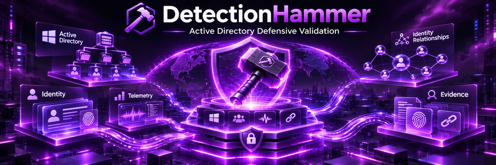

<p align="center">
  
</p>

<h1 align="center">DetectionHammer</h1>
<p align="center"><strong>Prove what your defenses can see.</strong></p>
<p align="center">Active Directory · Detection Engineering · Evidence-first AI Skill</p>

<p align="center">
  <a href="https://github.com/icedracon/DetectionHammer/actions/workflows/evidence-checks.yml"></a>
  
  
  
  
</p>

<p align="center">
  <a href="#quickstart"><strong>Quickstart</strong></a> · <a href="#ad-knowledge-base">Catalog</a> · <a href="#evidence-first-workflow">Workflow</a> · <a href="#verification">Verification</a> · <a href="https://github.com/icedracon/DetectionHammer/issues">Feedback</a>
</p>

> [!IMPORTANT]
> **Development preview v0.0.1-dev.4. The complete candidate source is now in this repository; no official beta tag has been created.** The catalog and offline tools are available for review. Native agent activation, Sigma backend conversion, independent AI evaluations and live SIEM validation remain open. Use sanitized authorized evidence only. Do not equate scenario count, rule fixtures or ATT&CK associations with actual detection coverage. Public release/tag and CI status must be verified on GitHub.

<p align="center"></p>

## Why DetectionHammer?

A missing alert is not proof of a missed attack. DetectionHammer gives security engineers a structured way to review AD posture, telemetry, correlated alerts and prevention without confusing one for another. One portable skill, twelve specialist domains, local offline utilities, no attack runner or mandatory network connector.

| | Included in this package |
| :--- | :--- |
| **150** | AD defensive reference scenarios, each with draft scenario-specific evidence methodology |
| **12** | Experimental Sigma event-visibility rules (not attack detectors) |
| **34** | ATT&CK associations reviewed at definition level; independent review pending |
| **96** | Synthetic rule fixture assertions |
| **20** | AI evaluation cases, with three-condition scoring infrastructure; real trials pending |

## Quickstart

Clone the repository. From the project where you want the skill:

**Claude Code**

```bash
git clone https://github.com/icedracon/DetectionHammer.git
mkdir -p .claude/skills
cp -R DetectionHammer/skills/detectionhammer-ad .claude/skills/
```

**Codex**

```bash
git clone https://github.com/icedracon/DetectionHammer.git
mkdir -p .agents/skills
cp -R DetectionHammer/skills/detectionhammer-ad .agents/skills/
```

<details>
<summary>Windows PowerShell</summary>

```powershell
git clone https://github.com/icedracon/DetectionHammer.git
New-Item -ItemType Directory -Force .claude/skills, .agents/skills | Out-Null
Copy-Item -Recurse DetectionHammer/skills/detectionhammer-ad .claude/skills/
Copy-Item -Recurse DetectionHammer/skills/detectionhammer-ad .agents/skills/
```

</details>

Directory-copy and relocated offline CLI checks are tested locally. Actual discovery, activation, plugin marketplace installation and `npx skills` compatibility are not certified. Refresh your agent and verify that it discovers `detectionhammer-ad`.

Try this in an authorized lab, using sanitized records:

> Use detectionhammer-ad to review my exported Active Directory security evidence. Separate telemetry, correlated alerts and independently supported prevention. Explain incomplete evidence and propose defensive improvements.

## Evidence-first workflow

<p align="center"></p>

The skill uses a context interview and intent router, loads only the relevant AD module, checks telemetry and source completeness, considers legitimate alternatives, then writes an evidence-qualified report. See the [workflow](skills/detectionhammer-ad/references/workflows.md) and [report template](skills/detectionhammer-ad/references/report-template.md).

| Evidence dimension | What must be kept separate |
| :--- | :--- |
| Posture | Observed settings versus potential security implications |
| Execution | Independent evidence of authorized activity |
| Telemetry | Availability of raw observations and source health |
| Alert | Correlation with a specific observed alert |
| Prevention | Independent evidence of a defensive outcome |

<p align="center"></p>

## AD knowledge base

<p align="center"></p>

| Domain | Cards | Domain | Cards |
| :--- | ---: | :--- | ---: |
| [Kerberos](skills/detectionhammer-ad/references/krb.md) | 20 | [NTLM](skills/detectionhammer-ad/references/ntl.md) | 12 |
| [LDAP](skills/detectionhammer-ad/references/ldap.md) | 10 | [AD CS / PKI](skills/detectionhammer-ad/references/pki.md) | 20 |
| [Delegation](skills/detectionhammer-ad/references/del.md) | 12 | [ACL & permissions](skills/detectionhammer-ad/references/acl.md) | 15 |
| [DC & replication](skills/detectionhammer-ad/references/dc.md) | 10 | [Group Policy](skills/detectionhammer-ad/references/gpo.md) | 10 |
| [Lateral movement](skills/detectionhammer-ad/references/lat.md) | 12 | [Identity security](skills/detectionhammer-ad/references/idn.md) | 10 |
| [Domain trusts](skills/detectionhammer-ad/references/tru.md) | 9 | [Persistence & controls](skills/detectionhammer-ad/references/per.md) | 10 |

[Module index](skills/detectionhammer-ad/references/index.md) · [JSON catalog](skills/detectionhammer-ad/references/catalog.json) · [CSV catalog](skills/detectionhammer-ad/references/catalog.csv) · [ATT&CK review](skills/detectionhammer-ad/references/attack-review.md)

The 150 cards include 100 evidence-review and 50 configuration-review scenarios; they are not executable attacks. The AD CS ESC checklist is separate from the count. All scenario methodologies remain subject to technical review.

## Verification

Run from the complete package root:

```bash
python -m pip install -r requirements-dev.txt
python -m unittest discover -s tests -v
python skills/detectionhammer-ad/scripts/dh_review.py validate
python skills/detectionhammer-ad/scripts/dh_review.py fixtures
python skills/detectionhammer-ad/scripts/evidence_review.py examples/evidence.json
```

The synthetic partial-search example must return `INCONCLUSIVE`; a missing alert is not automatically a missed detection. The offline evaluator checks analyst assertions and never grants live coverage credit.

| Verification | Previous local candidate test result |
| :--- | :--- |
| Unit/integration test methods | 21 passed |
| Catalog integrity | 150/150 |
| Synthetic visibility fixtures | 96/96 |
| Evidence-gate combinations | 1,536 checked |
| Native Claude / Codex / npx skills | Not verified |
| Native Sigma backend conversion / live SIEM | Not verified |
| Comparative AI trials | 0/60 completed |
| Public GitHub CI | See live workflow badge; not independently confirmed here |

See [test log](TEST_RESULTS.txt), [beta gates](BETA_GATES.md), [Sigma validation](SIGMA_VALIDATION.md) and [AI evaluation protocol](EVALS.md). Wazuh, Elastic, Sentinel, Splunk, Defender and Kaspersky are integration guidance targets, not tested live API connectors. [Integration notes](skills/detectionhammer-ad/references/integrations.md).

## Interactive product tour

[Website source](docs/index.html) · [GitHub Pages settings](https://github.com/icedracon/DetectionHammer/settings/pages). Illustrative animation and evidence cases, not live coverage.

## Help shape the beta

- Report installation or activation issues, with the agent and version.
- Submit sanitized sample records or reproducible synthetic fixtures for a false-positive concern.
- Review a scenario's evidence assumptions, official references or legitimate alternatives.
- Share independent agent benchmark results with the predeclared rubric.

See [contributing](CONTRIBUTING.md), [security policy](SECURITY.md) and [changelog](CHANGELOG.md). License selection is pending maintainer approval; no open-source license grant is asserted by this preview. No hidden usage tracking; AI clients' own processing policies are separate. No automatic production changes, credential collection, exploitation or attack execution.

<p align="center"><strong>ICEDRACON / One flagship skill. Deep AD specialization. Measurable evidence.</strong></p>
